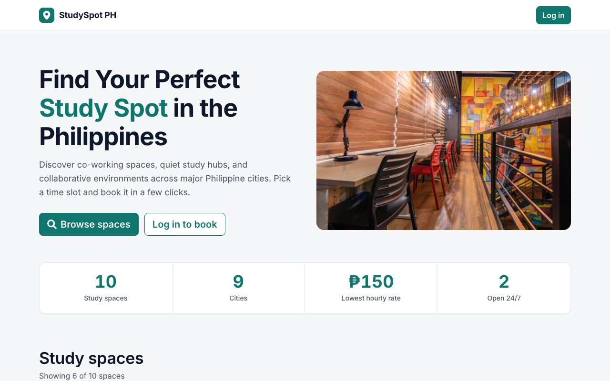
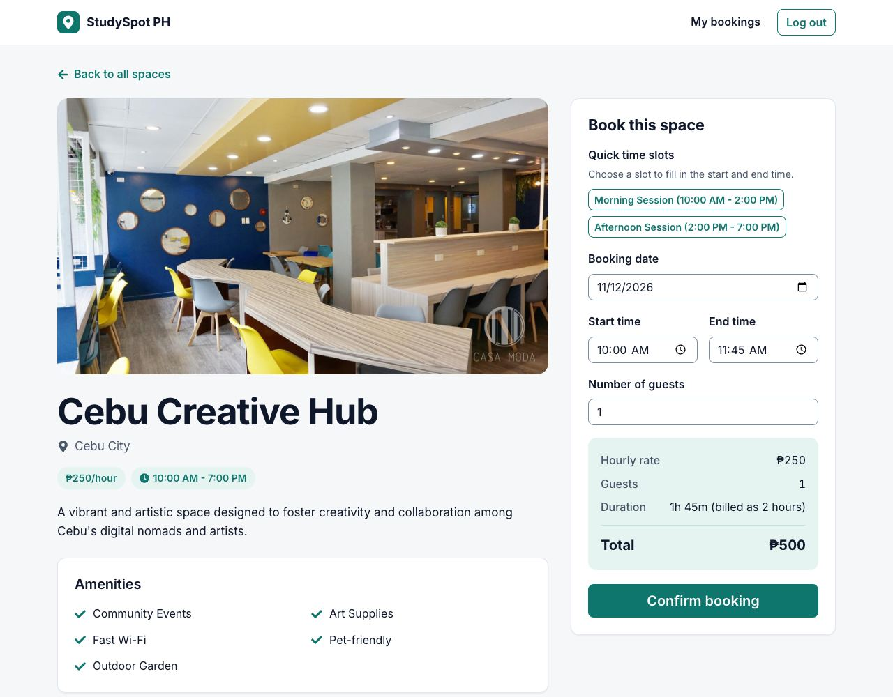
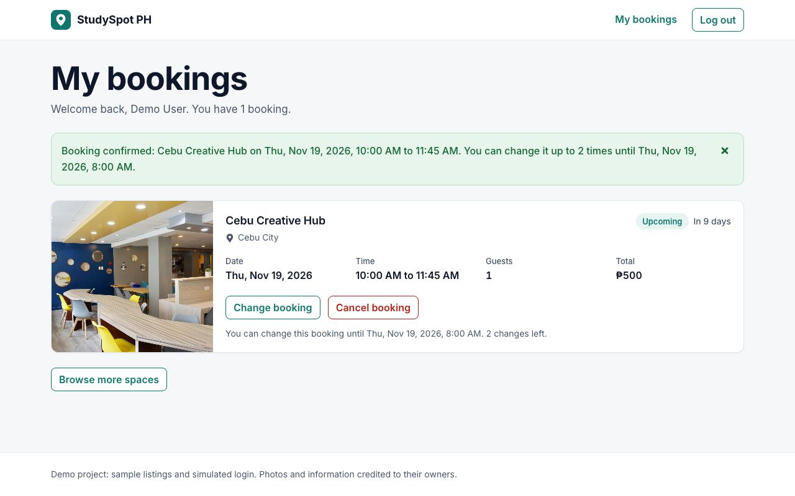
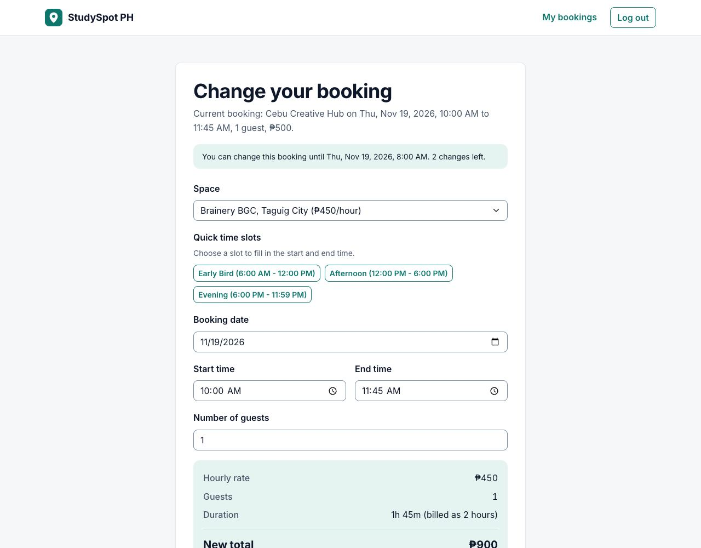
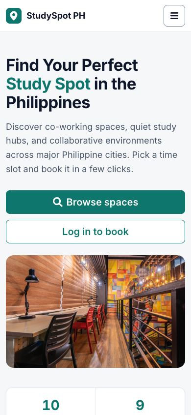

# StudySpot PH

A study-space booking web app for the Philippines: browse spaces, check the hourly rate, and book a time slot. Built solo with React for my Web Development midterm (September 2025).

## Live demo

**https://midterm-project-three-gray.vercel.app**

Log in with any name and email to try booking. The login is simulated and all data stays in your browser.

| Home | Space details and booking form | My bookings |
|---|---|---|
|  |  |  |

Changing a booking:



On a phone (390px wide):



## Features

- Browse study spaces: six on the home page when logged out, all of them after logging in
- Search by name or city (after login), with a live count of the results
- Space page with the photo, location, hourly rate, opening hours and amenities
- Booking form with date, start and end time, number of guests, and quick time slots
- Live price summary that updates as you change the time or guests
- Form validation (React Hook Form + Yup), with the messages shown next to each field
- Overlap and zero-length checks, so the same space cannot be double-booked
- One booking per space per user
- My bookings page with upcoming and completed bookings, and one message for the latest action (booked, changed or cancelled)
- Change a booking (space, date, times and guests) on its own page, up to 2 times and before a deadline, with the new price and the difference shown
- The change deadline is shown before booking, in the booking confirmation, and on each booking with a countdown that updates every 30 seconds
- Cancel a booking from a confirmation dialog
- Protected My bookings page; logging in brings you back to the page you came from
- Bookings kept in the browser's `localStorage`
- Responsive layout with a menu button on small screens
- Page not found page for unknown addresses and unknown space ids

## Tech stack

| Part | Tools |
|---|---|
| UI | React 19.1 (JavaScript), Vite 7.3 |
| Routing | React Router 7.18 |
| Forms | React Hook Form + Yup |
| Styling | Bootstrap 5.3 (CSS only, no Bootstrap JavaScript), customised with design tokens in [`src/styles/theme.css`](src/styles/theme.css); react-icons; small per-component CSS files |
| Font | Inter, self-hosted with [`@fontsource-variable/inter`](https://fontsource.org/fonts/inter) (SIL Open Font License 1.1) |
| State | Context API (`AuthContext`, `BookingContext`) + a `useLocalStorage` hook |
| Tests | Vitest: 97 unit tests in 8 files (booking rules, change deadlines, notices, opening hours, date and time formatting, quick time slots, home page stats, time validation) |
| Hosting | Vercel |

## Booking rules

The rules live as plain functions in [`src/utils/bookingRules.js`](src/utils/bookingRules.js) (the checks shared by the booking and change forms), [`src/utils/bookingTime.js`](src/utils/bookingTime.js) (times, prices and overlap) and [`src/utils/bookingChanges.js`](src/utils/bookingChanges.js) (the change deadline). The quick time slots are read by [`src/utils/timeSlots.js`](src/utils/timeSlots.js). Unit tests sit next to each file.

- **Billing:** every started hour is billed. 1h 45m is billed as 2 hours. Total = billed hours × hourly rate × guests.
- **Start and end:** the start time and end time must be different.
- **Overlap:** a new booking is rejected if it overlaps any confirmed booking for the same space, by any user, on any date. Back-to-back bookings are allowed (one ends at 13:00, the next starts at 13:00).
- **Overnight:** an end time earlier than the start time means the booking runs into the next day. This is only allowed for spaces open 24/7, and overnight bookings are included in the overlap check.
- **Passes:** pass-style slots are billed the same way (hourly rate × hours × guests), so Full Day (24 hours) at ₱500/hour is ₱12,000 per guest.
- **Changing a booking:** an upcoming booking can be changed (space, date, times and guests) up to 2 times, until 2 hours before it starts, or for 30 minutes after it was booked if that gives more time, and never after it starts. The new details go through the same checks as a new booking; a booking never overlaps with itself, and you cannot move it to a space where you already have another booking. Saving without any change does not use up a change. Cancelling has no deadline.

## Design and accessibility

What was checked (November 2026), and how:

- **Widths:** every page and state (home logged out and in, space page logged out, with the form and with an existing booking, login with errors, My bookings empty, with bookings, with each kind of message and with the cancel dialog open, the change page in its normal, warning and "can't be changed" states, and the 404 page) at 320, 390, 768, 1024 and 1440px wide, plus 200% zoom on a 1280px window. No sideways scrolling; screenshots of each were reviewed.
- **Touch targets:** buttons, links in the header and form fields are at least 44px tall below 768px.
- **Keyboard:** keyboard-only runs at 390px and 1440px: skip link, menu, log in, search, open a space, pick a quick slot, enter the date, book with Enter, change the booking twice (including the space), reach the disabled Change booking button (its reason is linked with `aria-describedby`, and pressing it does nothing), cancel a booking in the dialog, log out. Every focused element shows a visible focus ring. When a booking can no longer be changed, its Change booking button stays reachable with `aria-disabled` and a linked reason instead of disappearing.
- **Automated scan:** [axe-core](https://github.com/dequelabs/axe-core) 4.14 (WCAG 2.0/2.1 A and AA rules plus best practices) on each of the states above reported no violations. An automated scan cannot find every problem. The site was also tried on a real phone, in Safari and with a screen reader (November 2026, before the change feature was added).
- **Colour contrast** of the design tokens (computed with the WCAG formula):

  | Pair | Ratio |
  |---|---|
  | White text on the teal primary `#0F766E` | 5.47 |
  | Body text `#0F172A` on white | 17.85 |
  | Secondary text `#475569` on white / on the page background | 7.58 / 7.07 |
  | Teal text on the light teal chip background | 4.84 |
  | Input borders `#7C8DA3` on white | 3.39 |
  | Success, error and warning text on their message backgrounds | 6.35, 5.75, 6.37 |

- **Motion:** no movement on hover; smooth scrolling and transitions are switched off when the system asks for reduced motion.

## Run locally

Requires Node.js 20.19+ or 22.12+ (needed by Vite 7).

```bash
npm install
npm run dev      # start the dev server at http://localhost:5173
npm test         # run the unit tests
npm run build    # build for production into dist/
npm run lint     # run ESLint
```

## Deployment

The app is deployed on Vercel as a static site. [`vercel.json`](vercel.json) rewrites every path to `index.html`, so direct links such as `/space/1` work. Addresses the app does not know show its Page not found page.

## Known limitations

- The login is simulated: any valid name and email works, and there is no password.
- Data lives only in the browser's `localStorage`, so bookings are not shared between devices or users.
- The listings and photos are sample data.
- There is no backend.
- The change rules (2 changes, the 2-hour cutoff and the 30-minute grace period) are demo rules and live in [`src/utils/bookingChanges.js`](src/utils/bookingChanges.js). All data and the time checks live in the browser, so someone who edits the saved data or the computer's clock can get around them. A real service would check the time on a server.
- Light theme only.

## Future improvements

- A real backend and authentication, which would also check the change deadline on a server
- A cancellation deadline and email reminders
- More tests, including component tests
- Smaller image versions for phones

## Credits

Photos and information come from online sources and belong to their respective owners.
